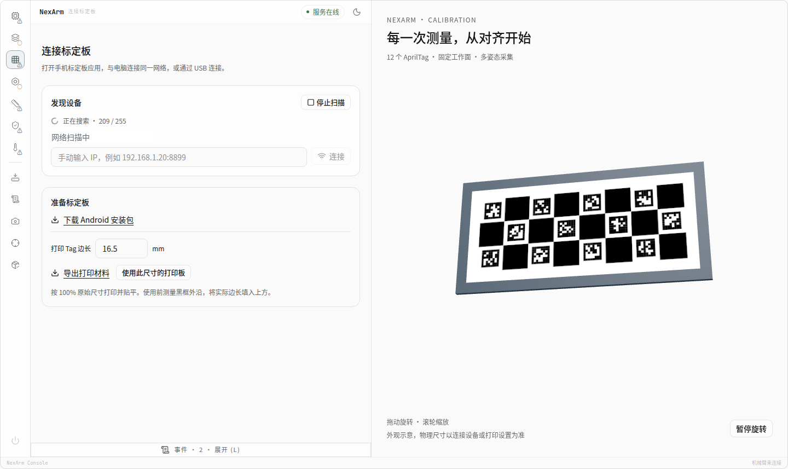
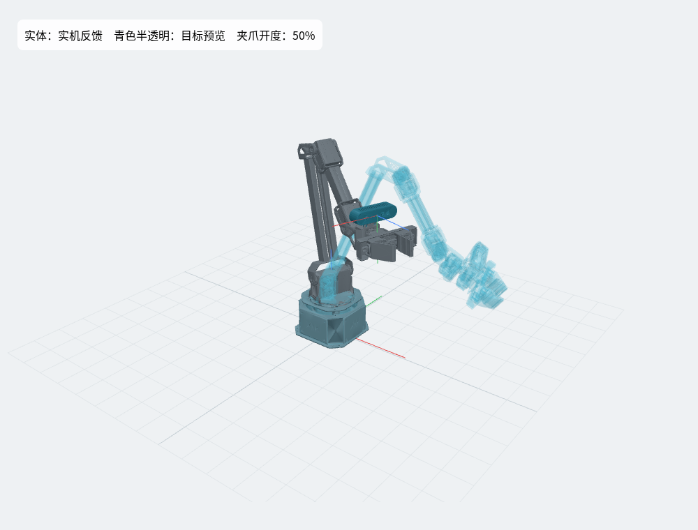
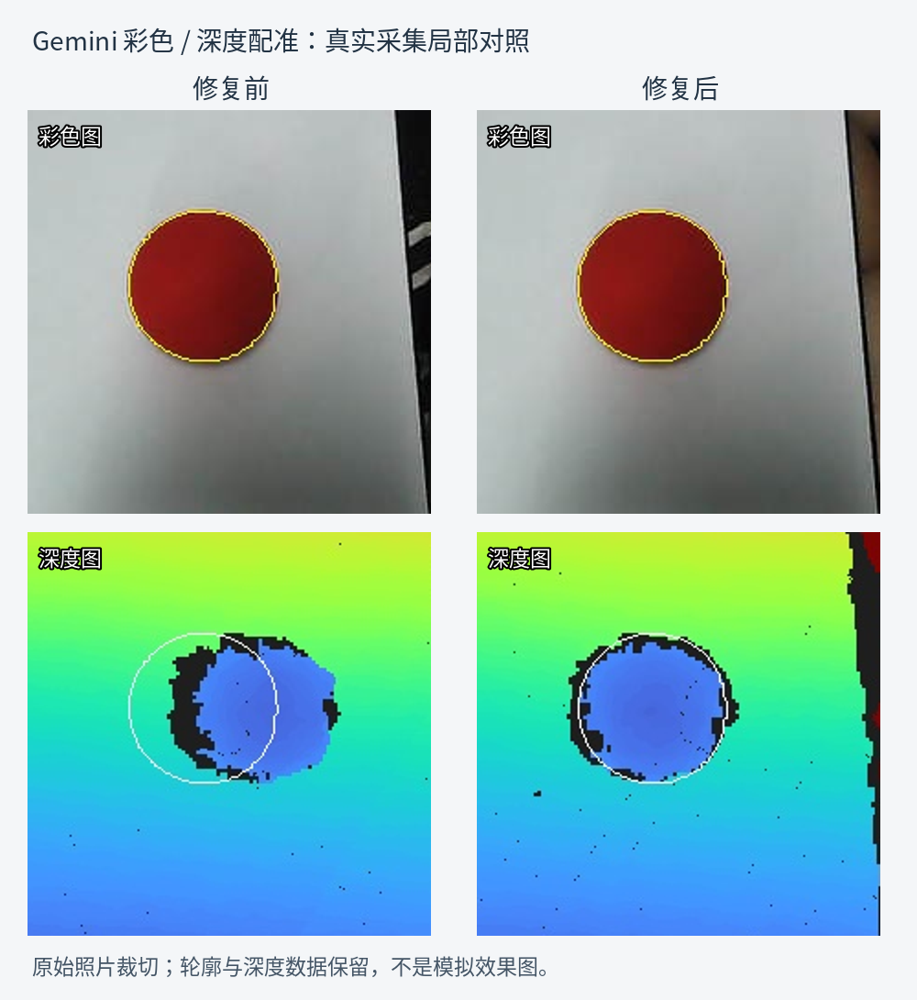

# NexArm & Buslinker

**Rust + C++ Windows 标定上位机**

面向 NexArm 机械臂与 Buslinker 控制器的 Windows 桌面工具。

- 设备连接与运行状态查看
- 机械臂、舵机与运动参数配置
- 相机、工作台与手眼标定
- 3D 状态预览
- 工作站配置导入与导出

## 上位机预览

### 设备连接与标定板

### 机械臂 3D 预览

### 深度标定

## 下载

在 [Releases](https://github.com/KerveinWork/a2vec/releases) 下载 Windows x64 安装包。
